# Cierre del PR #10 · grupo «física y pendientes»

Rama del worktree `worktree-agent-ad0f910203acd70a2`, sobre `da08e3a` (motor de `16ca1f4` más la referencia de los 203 presets). Encargo: tres filas del Anexo 1 sobre familias de simulación existentes (I-04, I-14, I-24) y los pendientes por familia del §9 y de los informes de grupo, salvo `ecos`, `humo`, `lente_gravitacional`, `cromado` y `desgarro` (otro grupo).

Commits:

| SHA | Contenido |
| --- | --- |
| `86e8341` | Malla cinética (I-04), lazos de tinta (I-14) y chorro sumergido (I-24) |
| `b6b4969` | Pendientes por familia: DLA, Continentes, Nadadores, Montaña viva, Coral, nubes, Mandala y cámara de niebla |
| `c3e0859` | Cuerpo blando por presión (cojín) y «Faro» como bucle exacto |
| `b5bc5b6` | Haces de luz con más sol y menos contraste; paleta del cojín; el segundo trazador sólo en el estado de una corrida que lo usó |
| `d4b748a` | Trae `5c944e6` (parámetros por versión, `ParamSpec.since`) y las familias de los otros grupos; índice regenerado |
| `a206e73` | Controles nuevos con su versión: tela 2, fluido 2, erosión 2, Lenia 3, nubes 2 |
| (este) | Informe, capturas y resultados de la sonda |

## Cómo se midió

- **Sonda temporal** (`scripts/families-time.ts`, compilada a `.cache/ft-fisica.mjs`): antes de tocar nada (`.cache/antes/*.json`) y después (`.cache/despues/*.json`), con las órdenes de `.cache/antes/run.sh` y `.cache/despues/run.sh`. `m` es el % medio de cambio del raster en el medio segundo siguiente con la cámara quieta; `l`, el % del lienzo con tinta (> 24/255). La máquina estuvo compartida con otros agentes (carga 3–13 en 4 núcleos): las cifras de coste son cotas altas, no mediciones finas.
- **Raster** mirado en PNG con un arnés propio (`.cache/x/viz.ts`): el modelo desde su semilla, a la resolución y versión que se pidan.
- **Capturas ASCII** en Chromium 141 con WebGL 2 por SwiftShader (`dev/familias.html` a 1280 × 720, celda 10 salvo donde se dice), con un script propio que guarda cada lienzo a tamaño real (`.cache/x/snap.mjs`), y **paridad de motores** con `scripts/families-qa.mjs --compare`.
- **Antes/después** del mismo código: para las familias que suben de versión, la v1 se dibuja con el código de `da08e3a` extraído con `git archive` (`.cache/x/gen-fixture.ts`), y la referencia resultante es una prueba (ver «Compatibilidad»).

## A. Filas del Anexo 1

### I-04 · Malla cinética (`tela`)

**Mecanismo.** Anclaje nuevo «Todo el borde (tensa)»: una rejilla de muelles de 2 × 1 (33 × 17, 41 × 21 o 49 × 25 partículas, celdas cuadradas) sujeta por todo el marco, de frente a la cámara y llenando el cuadro. Sus muelles reposan un 3 % más cortos que la rejilla (la malla está tensa y transmite ondas) y su rigidez tiene la escala de una red de muelles (α = 10^(2 − 2,5 · Rigidez)), no la de los hilos de una tela, para que la onda se vea cruzar: con «Rigidez» 0,8 la compresión cruza el lienzo en un segundo largo. Sin gravedad. «Golpes» y «Un golpe cada»: cada «Cada» segundos un impulso entra por un borde que elige una corriente propia de la semilla (`tela|golpes|semilla`; sin golpes la corrida es exactamente la de antes): los nudos cerca de ese punto del borde reciben velocidad hacia dentro de la malla y algo fuera de su plano. Vista nueva «Tensión de la malla»: cada muelle estructural se dibuja con la tinta de lo que se aparta de su estiramiento en reposo (|d/L − 1|, lleno al 5 %), así que el glifo y la paleta siguen la tensión. En las demás anclas, «Golpes» golpea la tela de través.

**Diferencia visible.** `membrana` era una lámina sujeta por cuatro esquinas, con gravedad, golpeada por una esfera. Aquí es una rejilla que llena el lienzo, sujeta por todo el marco, sin gravedad, en la que cada golpe abre un anillo de tensión que cruza la malla, rebota en el marco y se apaga; los muelles se encienden al estirarse.

- Preset `malla_cinetica` «Malla cinética» (aka Kinetic grid, Red de muelles, Membrana tensa golpeada): `arte/geometricas`, `fondos/geometricas`; contrato **continuo** (golpes cada 1,8 s). La regla de tiempo cuenta ahora «Golpes» (y la respiración del cojín) además de viento y esfera; `figure` es una función: la malla de todo el borde llena el cuadro, el resto de telas siguen siendo figuras.
- Sonda: `m` 12–22 % sostenido hasta 600 s (tres resoluciones, dos semillas), tinta 43–74 % (la malla en reposo es una rejilla tenue que ocupa el cuadro por diseño). Coste ≤ 17 ms por 0,5 s simulado.
- Archivos: `src/families/sims/tela.ts`, `src/families/meta/tela.ts`, `src/families/meta/tela.doc.ts`.
- Pruebas (`tests/unit/family-tela.test.ts`, «malla cinética (I-04)»): sin golpes se queda en su rejilla y es construcción; los golpes llegan cada «Cada» desde más de un borde, el marco no se mueve; la onda llega lejos del borde y se amortigua; la vista «Tensión» se enciende con el golpe; determinismo y restauración exacta con la corriente de golpes; llena el cuadro y las demás telas siguen siendo figuras.
- Paridad: r = 1,0000, 99,9 % de glifos iguales.

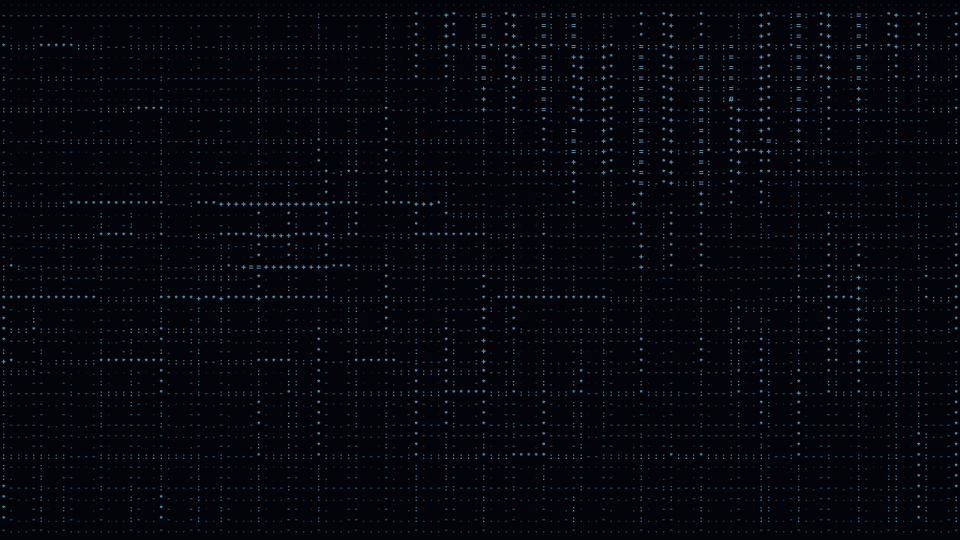

### I-14 · Lazos de tinta: fluido con emisores orbitales (`fluido`)

**Mecanismo.** Chorros nuevos «Emisores en órbita»: cada emisor recorre una elipse alrededor del centro más un epiciclo al menos cinco veces más rápido y lo bastante ancho para que, en los extremos de la elipse, el emisor corra hacia atrás: su camino traza lazos (`orbitAt`, exportada y probada). El emisor sopla a lo largo de su propio camino (su velocidad), así que la tinta queda en lazos que la vorticidad alta enrosca. Tinta nueva «Un tono por emisor»: cada emisor echa tinta de fuerza distinta (1, 0,7 y 0,48), que la paleta convierte en tres tonos.

**Diferencia visible.** `tinta_agua` deja caer bocanadas desde arriba; aquí tres emisores dan vueltas por todo el lienzo y dejan trazos en lazo de tres tonos que se enroscan.

- Preset `lazos` «Lazos de tinta» (aka Emisores en órbita, Tinte que traza lazos, Refuerzo de vorticidad): `fondos/organicas`, `arte/organicas`; **continuo**. Vorticidad 0,85, vista tinta.
- Pruebas (`family-fluido.test.ts`, «emisores en órbita (I-14)»): con los valores extremos de las semillas el camino corre hacia atrás más del 5 % del tiempo y su rumbo da más de tres vueltas por órbita (lazos), sin salir de la caja; «Un tono por emisor» echa menos tinta con la misma corriente; la prueba corta de cada preset continuo.
- Paridad r = 1,0000, 100 % de glifos.

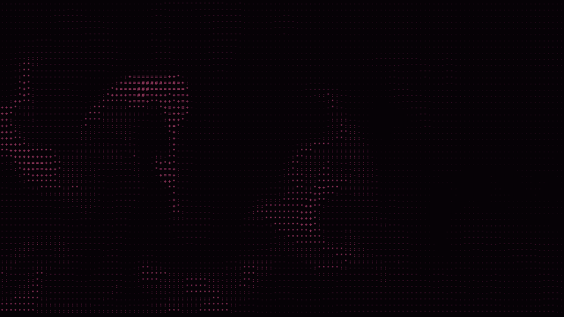

### I-24 · Chorro sumergido (`fluido`)

**Mecanismo.** Chorros nuevos «Chorro sumergido (desde el fondo)»: una boquilla en el suelo de la caja (caras con velocidad de entrada) sopla hacia arriba y la **tapa de arriba está abierta**: presión 0 más allá de la última fila en la proyección y caras sin cerrar, así que lo que entra por la boquilla sale por arriba (la tinta no se renormaliza como en la caja cerrada). «Perturbación de cizalla» (parámetro nuevo) sacude de lado los dos bordes del chorro justo encima de la boquilla, con dos frecuencias de la semilla y desfasados entre sí: el empujón que las capas de cizalla necesitan para enrollarse en pares de remolinos (Kelvin–Helmholtz). **Dos trazadores**: el agua del núcleo de la boquilla lleva uno y la de sus bordes otro, transportados por la misma corriente y dibujados en dos tonos.

**Diferencia visible.** `pilares` es una corriente lateral alrededor de obstáculos; aquí una columna sube desde el fondo, se abre en hongos con los bordes enrollados (el segundo trazador dibuja las capas de cizalla) y sale por arriba sin llenar la caja.

- Preset `chorro` «Chorro sumergido» (aka Chorro turbulento, Inestabilidad de Kelvin–Helmholtz, Capa de cizalla, Dos trazadores): `fondos/organicas`, `arte/organicas`; **continuo** (la regla de tiempo cuenta el chorro aunque «Emisores» sea 0). Vorticidad media (0,4).
- Pruebas (`family-fluido.test.ts`, «chorro sumergido (I-24)»): lo que entra por la boquilla sale por arriba (diferencia < 10 %) y el resto del suelo está cerrado, divergencia baja; cada trazador entra por su parte de la boquilla y los dos suben; la tinta no se acumula en la caja; con la perturbación el chorro pierde antes la simetría; restauración exacta con el segundo trazador; contrato continuo.
- Paridad r = 1,0000, 100 % de glifos.

Los controles nuevos de `tela` y `fluido` tienen por defecto el comportamiento anterior y llegan con una versión nueva de la familia (`tela` 2, `fluido` 2, con `since: 2`): las capas de la versión 1, como las del azar congelado, no los reciben al normalizar. Sus presets publicados dibujan lo mismo (las dos referencias de `families-compat` en verde).

## B. Pendientes del §9 y de los informes

### DLA de construcción a 160 filas (`dla` → versión 2)

**Antes** (sonda, 160 filas, semilla del preset): Cristalización 5 % de tinta a los 30 s y 29 % a los 300 s (a 64 filas, 41 % terminado a los 30 s); Corona 7 % → 32 % a los 300 s; Raíces 10 % → 43 %; Colonias 11 % → 63 %; Arrecife 4 % → 13 %. El número de caminantes no escalaba con la rejilla en las construcciones.

**Cambio (v2).** «Caminantes» se cuenta en la rejilla de 64 filas: sin renovación, los caminantes crecen con el área de la rejilla y sus movimientos por paso con su lado. Cada caminante sigue andando y pegándose de uno en uno: no se adelanta el dibujo, se sueltan más partículas a la vez (como ya hacía el baño con renovación). A 64 filas las dos versiones dibujan lo mismo; la v1 conserva su camino en cualquier resolución.

**Después** (160 filas): Cristalización 36 % a los 30 s y terminada; Raíces 46 % a los 15 s; Corona 36 % a los 30 s; Colonias 53 % a los 15 s; Arrecife (adherencia 0,12, lento a propósito) 16 % a los 30 s y 27 % a los 120 s, como a 64 filas. Sigue siendo construcción: termina y se queda quieta. Coste ≤ 2 ms por 0,5 s.

- Archivos: `sims/dla.ts`, `meta/dla.ts` (versión 2), `meta/dla.doc.ts`.
- Pruebas (`family-dla.test.ts`, «dla v2»): a 160 filas la v2 llega a más del 60 % de lo que llega a 64 filas a los 30 s y la v1 a menos del 40 %; a 64 filas las dos versiones son iguales byte a byte; termina y queda quieta en un agregado del 20–60 %. Compatibilidad de la v1 a 160 y 48 filas en `families-compat` (abajo).

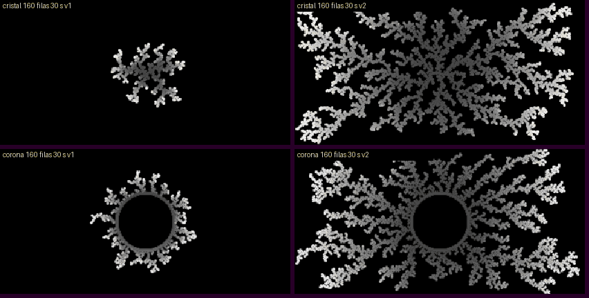

### «Continentes» depende de la semilla (`automata`)

**Antes** (sonda, Día y noche desde ruido al 50 %): a 64 filas la semilla del preset se apagaba (1 % de tinta a los 120 s) y las otras cinco quedaban entre 30 y 63 %; a 32 filas se llenaba entero (100 %). Es la coarsening de Día y noche en un toro finito: uno de los dos lados puede comerse al otro.

**Cambio.** Siembra nueva «Mapa de continentes»: ruido suave (dos octavas y un grano) comparado con su punto opuesto del toro (medio ancho y, con filas pares, media altura): una celda es tierra donde el ruido supera al de su opuesto, que entonces es mar. La tierra es exactamente la mitad y el mapa es su propio negativo al otro lado del toro; Día y noche trata igual lo vivo y lo muerto y conmuta con la traslación, así que **conserva esa simetría para siempre**: ni tierra ni mar pueden ganar, con cualquier semilla y número de filas. El preset usa esta siembra a 128 filas; sigue siendo **construcción** (las costas se pulen y los continentes se juntan despacio en unos minutos). No se ofrece variante continua: sin renovación Día y noche se detiene, y la renovación por lluvia ya se probó (informe de vida) sin un régimen estable.

**Después**: tierra 50,0 % a los 60 s en 3 semillas × 32/64/128 filas (prueba) y en la sonda de 4 semillas a 32/64/192 filas.

- Archivos: `sims/automata.ts`, `meta/automata.ts` (opción nueva, sin cambio de versión: las piezas guardadas tienen su siembra), `meta/automata.doc.ts`.
- Pruebas (`family-automata.test.ts`): la antisimetría se conserva generación tras generación (32, 33 y 64 filas); la tierra es la mitad con cualquier semilla y resolución, mientras la siembra anterior a 32 filas se va a un extremo; sigue siendo construcción y se va quedando quieta.

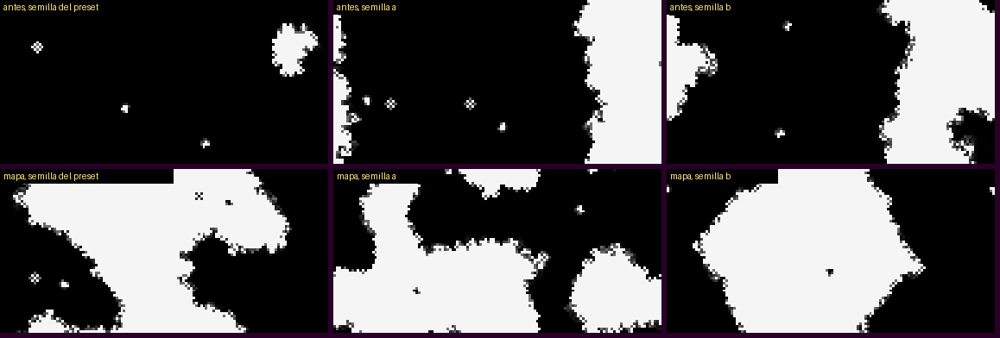

### «Nadadores» y «Anillos que nadan» ocupan poco (`lenia`)

**Antes**: 5 % y 3 % del lienzo. Probé primero apretar el banco (separación de 3,4 y 3 radios en vez de 4,5): con 3,4 radios dos de tres semillas perdían criaturas (tinta 3 % a los 10 min) y con 3 radios una colisión estallaba en una mancha que llenaba el 24 %. Descartado: la separación es lo que mantiene vivo el banco.

**Cambio.** «Estela» (parámetro nuevo, 0 = lo de antes exactamente): la materia deja una estela que se apaga en «Estela» × 6 s, calculada paso a paso (es estado: va en la instantánea y no depende de cuántas veces se dibuje), que la vista «Materia» pone bajo los cuerpos. Los presets se ven además algo más de cerca (escala de capa 0,8 y 0,75). Siguen siendo **figuras** (`arte/organicas`) y continuos.

**Después** (sonda, 10 min): Nadadores, cometas con estela que dicen hacia dónde nada el banco, 13–14 % de tinta (antes 5 %); Anillos que nadan, aros con estela corta, 9–10 % (antes 3 %). Lenia sube a la versión 3 por este control (`since: 3`).

- Archivos: `sims/lenia.ts`, `meta/lenia.ts`, `meta/lenia.doc.ts`.
- Pruebas (`family-lenia.test.ts`, «estela de los nadadores»): con estela hay casi el doble de lienzo con tinta y la materia es la misma; sin estela dibuja exactamente lo de antes; restauración exacta con estela; siguen en `arte/organicas` y más de cerca.

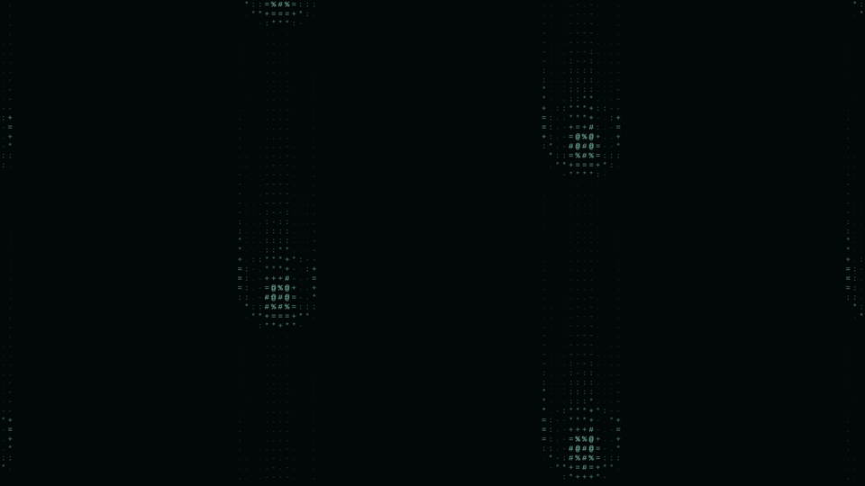
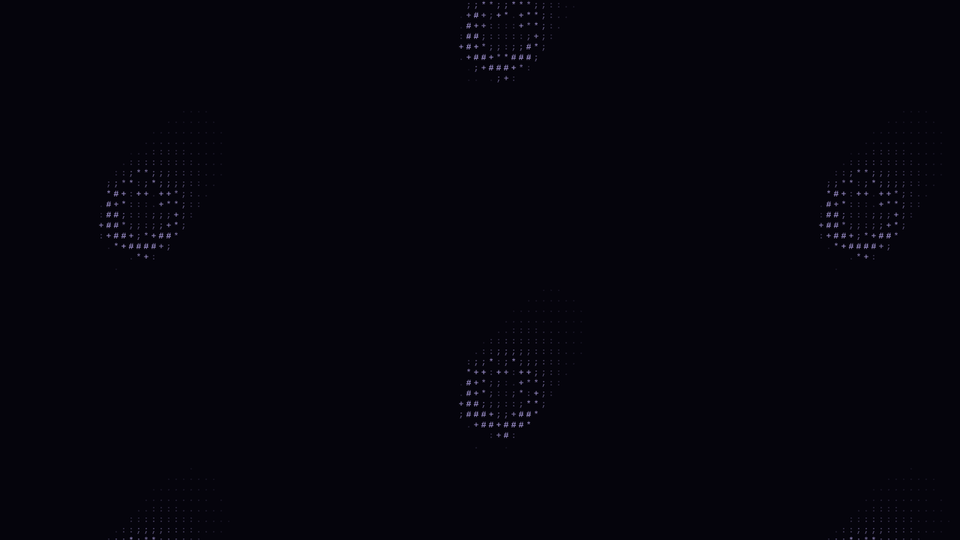

### «Montaña viva» y «Coral que respira», lentos (`erosion`, `reaccion_difusion`)

**Montaña viva. Antes**: `m` 0,21–0,28 % por medio segundo; con la cámara quieta, en 10 s cambiaba un 13–17 % de la figura (4 semillas). **Cambio**: parámetro «Ciclo del levantamiento» (segundos del ciclo de sus tres dibujos; 150 = lo de antes, con la fase calculada con la misma expresión, así que es idéntico byte a byte; cambiarlo en vivo sigue desde la fase alcanzada y va en la instantánea) y el preset con ciclo de 45 s, levantamiento 1, lluvia 1 y menos evaporación (más ríos que brillan). **Después**: en 10 s cambia un 25–27 % de la figura con la cámara quieta (4 semillas); la cámara sigue girando. No se ofrece una variante lenta: la anterior era la misma composición más despacio, sin otro valor; se llega a ella con los controles.

**Coral que respira. Antes**: `m` 0,55–1,06 %; una herida cada 4 s. **Cambio**: ritmo 0,6 → 2 (una herida cada 1,25 s); misma química y coste. **Después**: `m` 1,05–2,22 % desde los 30 s (dos semillas), con la misma tinta (81–83 %) y coste. No se ofrece variante lenta: el ritmo es un control del panel.

- Archivos (erosión sube a la versión 2 por el control nuevo, `since: 2`): `sims/erosion.ts`, `meta/erosion.ts`, `meta/erosion.doc.ts`, `meta/reaccion_difusion.ts`, `meta/reaccion_difusion.doc.ts`.
- Pruebas: `family-erosion.test.ts` (un ciclo más corto cambia dónde sube la tierra: 1 − correlación de dos ventanas de 10 s más de 5 veces mayor; Montaña viva cambia > 20 % de la figura en 10 s y > 1,4 veces lo de sus ajustes anteriores; cambiar el ciclo en vivo y restaurar es exacto); `family-reaccion_difusion.test.ts` (el preset cambia más de 1,5 veces lo que cambiaba con el ritmo anterior).

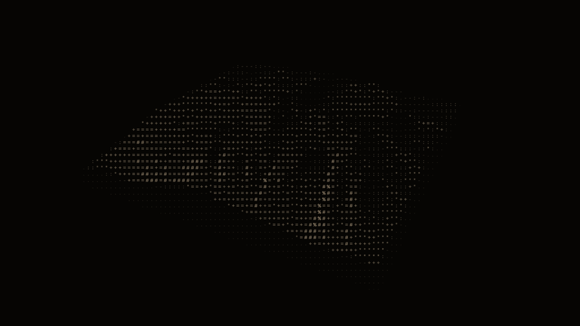
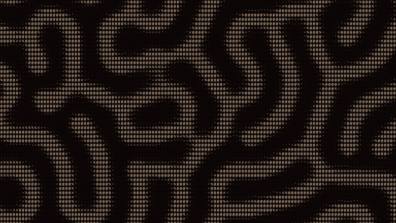

### Nubes por encima de ~97 % de tinta (`nubes_vol`)

**Antes**, mirando las capturas: «Haces de luz» era un velo tenue que ocupaba todo el cuadro (tinta 100 % a 0 s, 96 % a 120 s) con los haces casi invisibles; «Vuelo entre nubes» pasaba unos segundos dentro de una nube blanca sin detalle (97–100 %). El porcentaje no era el problema: lo era la falta de contraste y de estructura.

**Cambio.** Parámetro «Contraste» (posición 9 de los 16: `K2.x` en el shader, `k[8]` en el gemelo; 0 = la salida anterior exactamente): un punto negro bajo la bruma y el cielo más tenues y una ganancia sobre la luz. No toca la «Nebulosa», que ya tiene su punto negro. Haces de luz: contraste 0,3, sol 0,95 y absorción 2 (huecos oscuros, bordes de nube brillantes y haces más claros en la bruma; desviación de la mitad inferior 34–39 frente a 16–27). Vuelo entre nubes: contraste 0,3 y sol 0,6 (huecos de cielo oscuro y la nube que se atraviesa en gris con detalle, no en blanco).

**Después** (sonda): Vuelo entre nubes 37–77 % de tinta salvo el paso por dentro de la nube a los 60 s (99 %, ahora gris con detalle en vez de blanco); Haces de luz sigue llenando el cuadro (80–100 %: es un cielo con bruma) pero con huecos oscuros y haces. Decisión por apariencia: aceptable.

- Archivos (nubes sube a la versión 2 por el control nuevo, `since: 2`): `analytic/nubes_vol.ts`, `analytic/nubes_vol.cpu.ts`, `meta/nubes_vol.ts`, `meta/nubes_vol.doc.ts`.
- Pruebas (`family-nubes_vol.test.ts`, «contraste»): con 0 dibuja lo mismo; con el contraste del preset hay más huecos oscuros sin apagar la luz; el parámetro está en la posición 8 y el shader lee `K2.x`.
- Paridad: r = 0,9953 (haces) y 0,9905 (vuelo), dentro del rango que ya tenía este gemelo reducido (0,986–0,999).

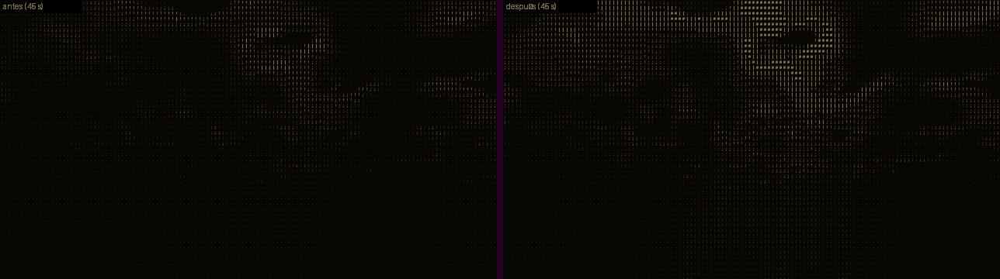
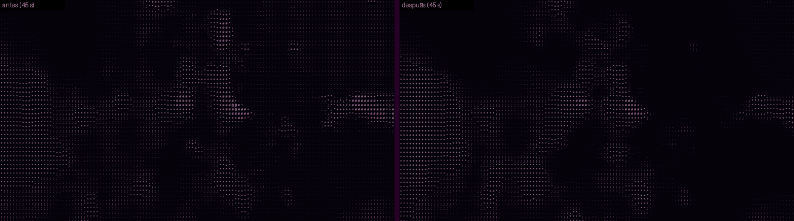

### «Mandala de arena» con disco gris central (`chladni` → versión 2)

**Causa** (raster a los 33 y 87 s): en algunos modos de la secuencia el centro de la placa apenas vibra; sus granos casi no se mueven y la arena queda repartida como la dejó el modo anterior, que la v1 dibujaba en gris medio (arena uniforme ≈ 0,48), y la vista «Arena y líneas» dibujaba como línea nodal todo el centro tranquilo (|u| pequeño en un disco).

**Cambio (v2)**: en las placas cuadrada y circular la arena repartida por igual queda oscura y sólo se enciende la que se junta (como ya hacía la placa de todo el lienzo), y la línea nodal se dibuja por su distancia |u| / |∇u| al cero del campo. Los granos caminan igual (mismo flujo de la semilla). La v1 conserva su dibujo.

**Después**: el centro de la placa a los 33 s queda a un 45–60 % del brillo de la v1 en tres semillas, y las líneas siguen saliendo (máximo > 200); las placas fijas (`placa`, `flor`) salen más nítidas.

- Archivos: `sims/chladni.ts`, `meta/chladni.ts` (versión 2), `meta/chladni.doc.ts`.
- Pruebas (`family-chladni.test.ts`, «chladni v2»): centro más oscuro con líneas en tres semillas; granos idénticos en v1 y v2. Compatibilidad de la v1 a 48 y 192 filas y en el momento del disco (abajo).

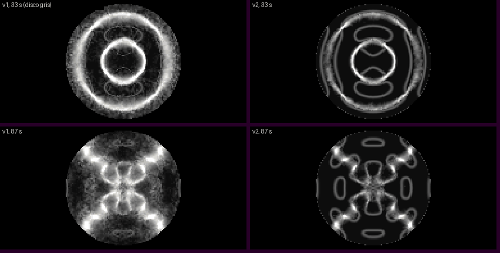
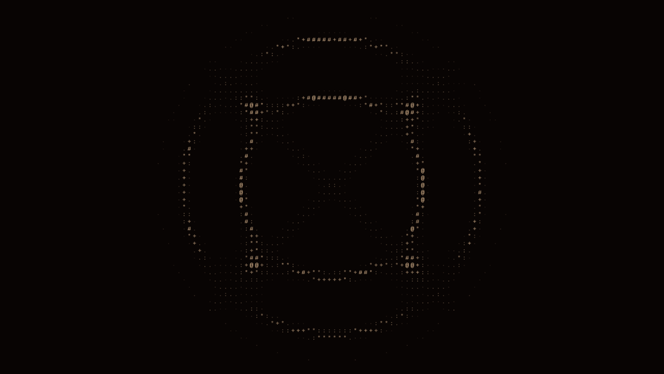

### Cámara de niebla legible sólo a 16 px (`niebla` → versión 2)

**Causa** (capturas a 10 y 16 px): con caracteres de 10 px una traza de 2 píxeles de la simulación cae entre dos filas de caracteres y sale como dos filas de glifos medios; la neblina de vapor viejo (realzada por la curva 0,6) llenaba el fondo de `.:` . A 16 px la traza cae en una fila. Además «Fuente alfa» dejaba la fuente en el tercio izquierdo (15–37 % de tinta, el resto vacío).

**Cambio (v2)**: la traza recién hecha se dibuja 1,7 veces más intensa (se satura: un carácter que sólo la roza ya recibe un glifo denso), la neblina por debajo de 0,06 se recorta, y la fuente radiactiva queda cerca del centro. Control nuevo «Grosor de traza» (1 = el grosor anterior) para adaptar las trazas al tamaño del carácter. Las partículas son las mismas que en la v1.

**Después**: legible con celdas de 10 px (las espirales salen como cadenas de `#%=`); paridad r = 1,0000 en los cuatro presets.

- Archivos: `sims/niebla.ts`, `meta/niebla.ts` (versión 2), `meta/niebla.doc.ts`.
- Pruebas (`family-niebla.test.ts`, «niebla v2»): más glifos densos (> 1,3 ×) y menos neblina tenue (< 0,7 ×) que la v1; las partículas son las mismas; «Grosor de traza» ensancha; la fuente está cerca del centro en la v2 y a la izquierda en la v1.

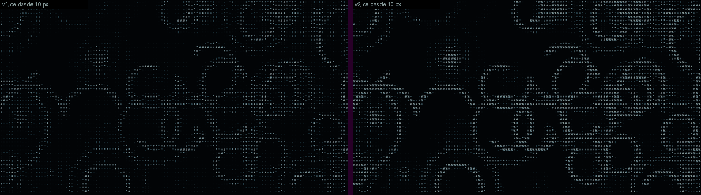

## C. Otros pendientes de los informes de grupo

| Pendiente (informe) | Decisión y evidencia |
| --- | --- |
| Cuerpos blandos por presión en Telas (física) | **Hecho.** Anclaje «Ninguno: cojín inflado (cuerpo blando)»: dos láminas cosidas por el borde y una restricción de volumen XPBD por subpaso (C = V − V₀, ∇ᵢC = ⅙ Σ xⱼ × xₖ), con «Inflado» y «Respiración». Preset `cojin` «Cojín que respira» (`arte/figuras`, continuo): cae, se apoya, respira cada 4 s y salta con golpes desde abajo. Sonda: `m` 0,4–1,7 %, tinta 20 %, ≤ 34 ms por 0,5 s a 96 filas. Pruebas: se infla y se sostiene sobre el suelo, más inflado es más grueso, respira, restauración exacta. 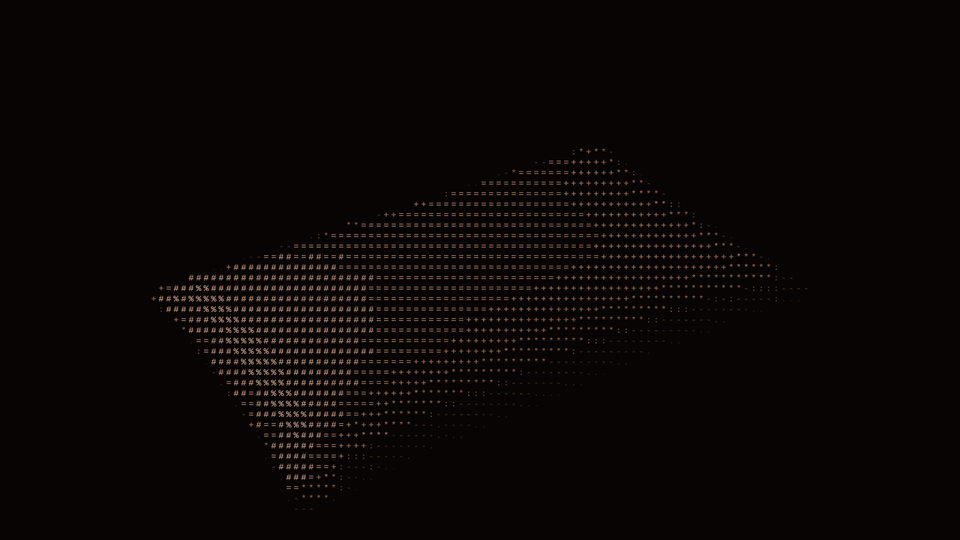 |
| «Faro» marcado continuo siendo periódico (figuras) | **Hecho.** La regla de tiempo de `orbitales` es una función: girando sin latido (mismo n, fase quieta o un solo estado) sólo se mueve la cámara y es un bucle exacto de 60 / giro s. «Faro» declara `period: 240`; prueba con el gemelo en t y t + 240 (< 1e-4). La prueba antigua del contrato («girando, continuo») se corrigió al contrato nuevo conservando lo que comprueba. |
| Flujos 3D con deriva 0 marcados como construcción (figuras) | Ya resuelto en la rama (la regla de `atractor` es una función que cuenta los flujos 3D). Sin cambios. |
| `figure` por preset; jardín y raíces de `sistema_l` como fondo (crecimiento, nuevas-a) | Ya resuelto (`figure` como función de los parámetros; el jardín está en `fondos/organicas`). Sin cambios. |
| Periodo del bucle por parámetro en `sistema_l` (crecimiento) | No se hizo: el preset declara su periodo; con otro «Crecimiento» el panel muestra el del preset. Es un cambio de `types.ts`/panel compartido, fuera de este grupo. |
| Tormenta de vórtices a 48 filas, 96 % (física) | Medido de nuevo: 79–96 % de 30 a 600 s, el máximo a los 30 s. Se conserva: no pasa de 97 % y la tormenta llena por diseño. |
| Agua v2 no idéntica a v1 (física) | Cerrado por diseño: es otra versión y la v1 conserva su dibujo (compatibilidad en verde). |
| `families-qa.mjs` sin navegador (física, crecimiento) | Cerrado: corrido aquí sobre los 18 presets tocados en los dos motores (r = 1,0000 salvo las nubes, gemelo reducido). |
| Lenia a 256 filas cambia menos (vida) | Medido: Sopa 0,44 → 0,20 % y Enjambre 0,21 → 0,10 % por medio segundo de 30 a 240 s a 256 filas, frente a 0,88–0,96 % estables a 128 (la tinta no cambia: 33 % y 17 %). La mitad se explica por la escala (criaturas el doble de grandes: menos borde por área); el resto, porque a 256 filas el campo se asienta más. Se conserva: 256 es el máximo opcional, el valor por defecto es 128. |
| «Red que se rehace» con grano leve (vida) | Mirado en captura: el grano de agentes recién llegados apenas se ve en glifos. Se conserva. |
| `colonia_viva` con huecos al deshacerse (crecimiento) | Se conserva: es el relevo de curvas, visible a propósito (su informe lo justifica). |
| `dragon_pliegue` con poca tinta en fases estiradas (crecimiento) | Se conserva: es una figura de línea (`arte/curvas`); engrosarla empastaría las fases plegadas. |
| Coste de las líneas de campo en movimiento (crecimiento) | No medido de nuevo aquí: la medición limpia de costes es del bloque de rendimiento (§12); bajo 250 ms/s según su informe. |
| «Lóbulos que laten» parece quieto (figuras) | Medido con muestras cada 2,5 s: cambia 0,30–0,52 % por medio segundo en mitad del latido y casi 0 en los extremos (t = 0, 10, 20 s…); la sonda de 0/30/60/120 s caía siempre en un extremo del bucle de 20 s. Se conserva. |
| «Cintas plegadas» con puntos sueltos 3–6 s; Mandelbulb y Mandelbox sin «liso» granulosas (figuras) | Se conservan: lo primero es la deriva elegida, lo segundo el camino de las recetas guardadas (ningún preset lo usa). |
| Supermuestreo de analíticas (figuras) | No se hizo: cambio de motor compartido, fuera de este grupo. |
| `runtime-families` en rojo por el tamaño de los scripts (nuevas-a, nuevas-b) | Cerrado: pasa en esta rama (el tamaño de celda llega por `prep`). |
| Lacería, Paneles, Membrana, Hipercubo; coste del básico de `celdas24`, `descargas/tormenta` (nuevas-a, nuevas-b) | Se conservan: son límites del mecanismo descritos en sus informes (cruces triples, mezcla «over» de vidrios opuestos, dos haces de Airy, el 24 celdas denso fuera de Terminal); el coste es comparable al de `corrientes`. |
| `latido` (marco) con pausas entre latidos (nuevas-b) | Se conserva: es su diseño y no se ofrece como fondo. |
| Entrada INERT `osciloscopio.grid`; muestra retenida con `floor(x/dl)` (nuevas-b) | Comprobado: paridad r = 1,0000 y 100 % de glifos en los cuatro presets a 480 × 270 (celda 7) y a 1280 × 720 (celda 10). Se conserva. |
| `niebla/fuente` escasa; trazas que dependen del tamaño de celda (nuevas-c) | Hecho (cámara de niebla v2, arriba). |
| Fase fundida de `orden_caos` cargada (nuevas-c) | Mirado en captura: es el contraste buscado entre cristal y flujo; se conserva. |
| Ecos, humo, agujero negro, cromado, desgarro | Fuera de este grupo. |

## Compatibilidad

- **Versiones nuevas que cambian el dibujo**: `dla` 2, `chladni` 2 y `niebla` 2. Cada una conserva el camino de la 1 (`cfg.v`) y su corriente aleatoria conserva la clave de la versión 1, así que la v2 camina, siembra y lanza igual que la 1 y sólo cambia lo que el encargo pedía.
- **Versiones nuevas por sus controles** (`ParamSpec.since`, de `5c944e6`): `tela` 2 («Golpes», «Un golpe cada», «Inflado», «Respiración»), `fluido` 2 («Perturbación de cizalla»), `erosion` 2 («Ciclo del levantamiento», con la fase de antes calculada con la misma expresión), `lenia` 3 («Estela»), `nubes_vol` 2 («Contraste») y `niebla` 2 («Grosor de traza»). Con su valor por defecto cada control dibuja lo de antes, y una capa de la versión anterior no lo recibe al normalizar (las tiradas congeladas del azar siguen siendo recetas canónicas: `generator.test.ts` en verde). Las corrientes aleatorias conservan la clave de la versión 1. Opciones nuevas de controles que ya existían (anclajes «Todo el borde» y «Cojín», vista «Tensión», chorros «Emisores en órbita» y «Chorro sumergido», tinta «Un tono por emisor», siembra «Mapa de continentes») no necesitan versión: una capa guardada lleva su opción. El índice de familias se regeneró (`npx tsx scripts/families-index.ts`).
- **Presets publicados**: las dos referencias de `tests/unit/families-compat.test.ts` (los 86 originales y los 203 del PR en su versión de entonces) pasan. Se cambiaron parámetros de presets (Continentes, Nadadores, Anillos que nadan, Montaña viva, Coral que respira, Haces de luz, Vuelo entre nubes): las recetas guardadas llevan sus parámetros y dibujan lo mismo; el Azar v7 lee su copia congelada.
- **Referencia nueva** `tests/unit/fixtures/families-cierre-fisica.json` (27 casos, escrita con el código de `da08e3a`): la v1 de `dla` (5 presets a 160 y 48 filas), `chladni` (4 presets a 192 y 48 filas, y el Mandala a los 33 s) y `niebla` (4 presets a 160 y 48 filas), donde la referencia de los 203 no llega. Cada caso exige que la v1 dibuje igual **y** que la versión actual dibuje otra cosa (si no, el caso no protegería nada).
- **Controles por versión**: otra prueba de `families-compat` comprueba, para tela, fluido, erosión, Lenia, nubes y cámara de niebla, que la versión anterior no lleva los controles nuevos, que la actual sí, y que normalizar de nuevo una capa antigua no cambia nada.

## Pruebas corridas (resultado real)

- `npx tsc --noEmit -p .`: sin errores.
- Sobre `a206e73` (con `5c944e6` y las familias de los otros grupos), en una ejecución: `npx vitest run` de `families.test.ts` (la batería entera, 55 familias), `families-compat.test.ts`, `families-index.test.ts`, `generator.test.ts`, `generator-v7.test.ts`, `generator-versions.test.ts`, `family-contracts.test.ts`, `runtime-families.test.ts` y `family-{tela,fluido,dla,automata,lenia,erosion,reaccion_difusion,chladni,niebla,nubes_vol,orbitales}.test.ts`: **19 archivos, 884 pruebas, todas en verde**. Después se añadieron las 6 pruebas de controles por versión: `families-compat` queda en 326 de 326 (86 + 1, Azar v6, 203 + 1, 27 + 1 y 6).
- Entradas nuevas en `INERT` de la batería: `tela.every`, `tela.inflate`, `tela.breath`, `fluido.shear`, `erosion.cycle` (sólo cuentan con golpes, el cojín, el chorro o el levantamiento).
- Navegador: `families-qa.mjs --compare` sobre los 19 presets tocados, en los dos motores: sin errores; r = 1,0000 y 100 % de glifos salvo las dos nubes (r 0,9962 y 0,9905, gemelo reducido, en el rango que ya tenía).
- Un fallo visto y explicado: con siete archivos de prueba a la vez y la máquina cargada, «guardar y restaurar a mitad de un mapa y de una herida» de reacción–difusión (prueba ajena) pasó de 5 s; sola, pasa (12 de 12). Mis pruebas pesadas declaran su tiempo (`timeout`), como ya hacía la compatibilidad.

## Sonda después del cambio

`.cache/despues/run.sh` y `run2.sh` sobre `a206e73` (máquina compartida: el coste es una cota alta). `m`: % de cambio del estado en medio segundo; `l`: % del lienzo con tinta; «coste»: ms por medio segundo simulado, máximo de las muestras.

| Preset | Filas · semillas | 0 / 30 / 60 / 120 / 600 s (`m` · `l`) | Mín. `m` desde 30 s | Coste |
| --- | --- | --- | --- | --- |
| tela/malla_cinetica | 96 · 2 | 13,5–14,1 · 74 / 15,9–17,4 · 74 / 18,4–19,7 · 74 / 14,1–15,5 · 74 / 12,5–14,5 · 74 | 12,5 (48 filas: 21,7; 192: 16,3) | 17 |
| tela/cojin | 96 · 2 | 13,2–13,4 · 20 / 0,4–1,2 · 20–21 / 0,9 · 20 / 1,6–1,7 · 20–21 / 0,9–1,1 · 21 | 0,42 | 34 |
| fluido/lazos | 128 · 1 | 5,3 · 14 / 10,6 · 51 / 8,3 · 49 / 8,8 · 44 / 9,1 · 49 | 8,3 (48 filas: 8,9, tinta 73–100; 192: 9,6) | 64 (192 filas: 108) |
| fluido/chorro | 128 · 1 | 2,7 · 11 / 8,8 · 40 / 8,2 · 37 / 6,9 · 31 / 9,1 · 46 | 6,9 (48 filas: 9,6; 192: 7,4) | 75 (192 filas: 173) |
| dla (5 construcciones) | 160 · 1 | cristal 9 → 36 % terminada a los 30 s; raíces 46 % a los 15 s; corona 36 % a los 30 s; colonias 53 % a los 15 s; arrecife 16 → 27 % de 30 a 120 s | (construcción: 0 al terminar) | 2 |
| automata/diaynoche | 128 · 3 | 24,5–25,7 · 73–74 / 3,9 · 53–54 / 1,9–3,2 · 52–53 / 1,8–2,4 · 52 | 1,8 (32 filas: 0,7 con tinta 51 %, antes 100 %) | 6 |
| lenia/orbium | 128 · 1 | 3,2 · 13 / 3,4 · 14 / 3,4 · 13 / 3,4 · 14 / 3,4 · 14 | 3,4 (tinta antes: 5 %) | 23 |
| lenia/anulares | 128 · 1 | 0,7 · 5 / 0,9 · 9 / 0,8 · 10 / 0,9 · 10 / 0,8 · 9 | 0,75 (tinta antes: 3 %) | 24 |
| erosion/montana | 112 · 2 | 0,4 · 24 / 0,3 · 24 / 0,3 · 24 / 0,3 · 23 / 0,3 · 23–24 | 0,27 (antes 0,21); en 10 s con la cámara quieta cambia el 25–27 % de la figura (antes 13–17 %) | 17 |
| reaccion_difusion/coral_vivo | 96 · 2 | 7,1–10,3 · 77–79 / 1,1–1,3 · 81–83 / 1,7–2,2 · 81–83 / 1,4–2,0 · 81–83 | 1,05 (antes 0,55) | 93 |
| chladni/mandala | 96 · 1 | 0,3 · 13 / 0,4 · 8 / 1,8 · 14 / 0,2 · 14 / 2,4 · 14 | 0,16 (cambio de modo) | 41 |
| chladni/placa · flor · musical | 96 · 1 | placa 0,3 · 8–9; flor 0,1–0,2 · 13 (construcciones); musical 0,9–2,6 · 8–11 | — | 21–54 |
| niebla (4 presets) | 80 · 1 | burbujas 8,4–11,1 · 49–73; rayos cósmicos 4,3–9,2 · 31–63; pares 7,6–10,6 · 42–72; fuente 3,0–5,6 · 12–30 | 3,0 (fuente) | ≤ 6 |
| nubes_vol/haces | 96 × 48 | 1,2 · 100 / 1,3 · 93 / 1,4 · 80 / 0,9 · 100 / 1,2 · 100 | 0,93 | 226 (gemelo) |
| nubes_vol/dentro | 96 × 48 | 4,0 · 46 / 7,6 · 77 / 10,3 · 99 / 5,6 · 52 / 4,9 · 63 | 3,8 | 134 (gemelo) |
| orbitales/hibrido (Faro) | 96 × 48 | 0,1 · 14 / 0,1 · 14 / 0,04 · 14 / 0,08 · 20 / 0,08 · 20 | 0,04 (la cámara da una vuelta en 240 s) | 42 |

Lecturas:

- Ningún continuo se queda quieto en las muestras. «Lazos de tinta» a 48 filas cuenta un 73–100 % de tinta: es una bruma tenue (brillo medio 23 %) con los lazos encima, no un lienzo saturado; a 128 y 192 filas, 44–51 %. «Haces de luz» sigue llenando el cuadro (es un cielo de nubes con bruma), ahora con huecos oscuros y haces: se decidió por la apariencia, no por el porcentaje.
- Coste: «Chorro sumergido» y «Lazos de tinta» a 192 filas (máximo opcional) pasan de 250 ms por segundo simulado en esta máquina cargada (346 y 216); a las filas por defecto, 150 y 128. Es el mismo orden que el resto de la familia `fluido`; la medición limpia es del bloque de rendimiento.

## Lo que no se hizo

- Variante continua de Continentes: Día y noche no tiene un régimen que se renueve sin llenarse o vaciarse (lo probó el grupo de vida); el preset sigue como construcción, ahora robusta.
- Variantes lentas de Montaña viva y Coral que respira: sin valor propio frente a los controles del panel.
- Periodo de bucle por parámetro, supersampling de analíticas y la medición de costes en máquina libre: cambios compartidos o del bloque de rendimiento.
- Color por celda (raster RGB) para la tensión de la malla o los trazadores del chorro: se resolvió por luminancia y paleta (la tinta es la tensión o el trazador); el color propio por celda queda para el grupo de color si se quiere.
