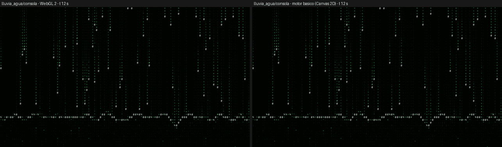
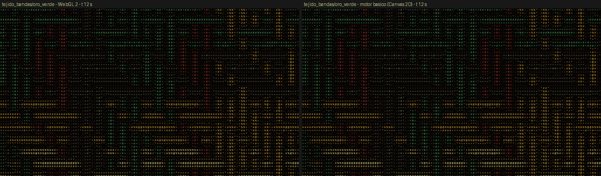
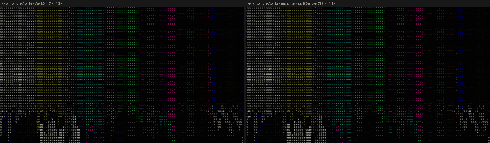
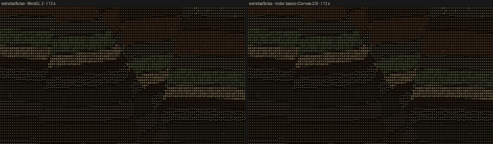
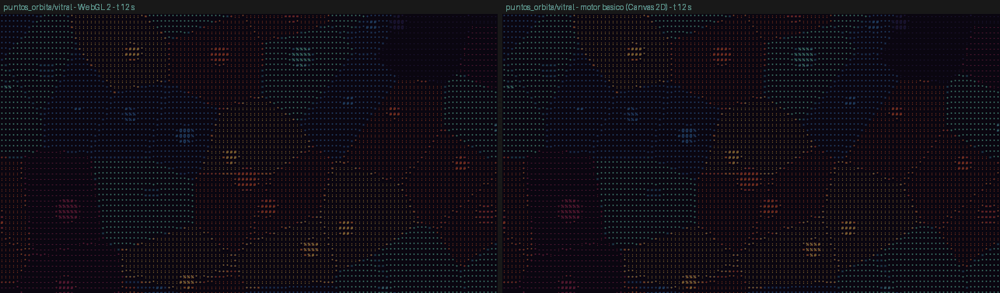
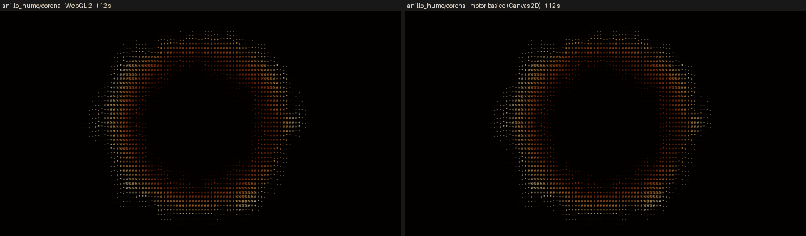
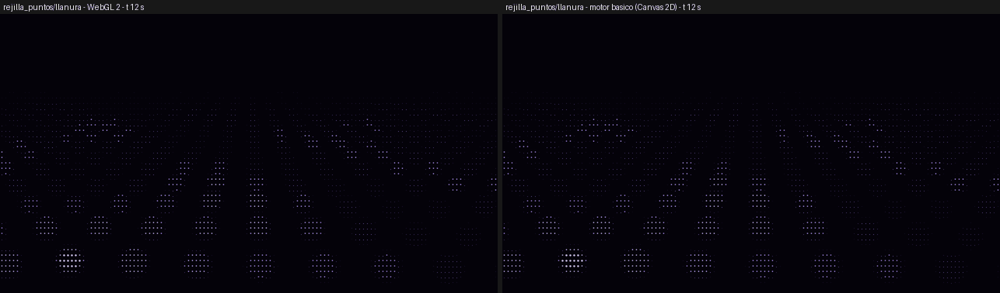
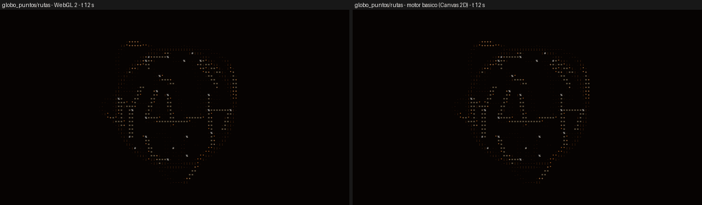
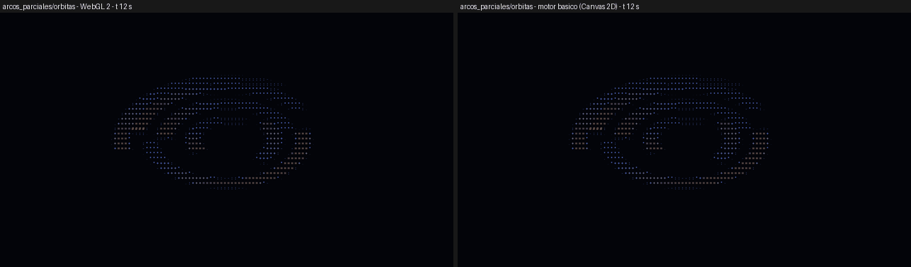
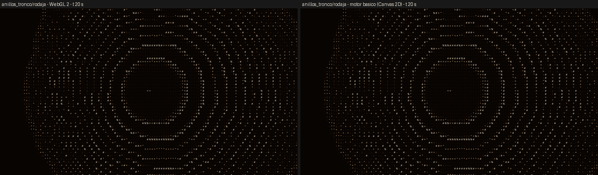

# Cierre del PR #10 · grupo «trama»

Filas del Anexo 1: I-15, I-17, I-19, I-23, I-25, I-26, I-28, I-29, I-30 e I-32.

Fecha: 12 de octubre de 2026. Base: `16ca1f4`, con el motor de 16 parámetros, la versión de familia, los rasters de color y la lectura de fuente.

## Qué se hizo

Ninguna de las diez filas se resolvió apilando capas de patrones existentes. Las recetas que sugería el inventario (por ejemplo, `lluvia` + `lluvia_mansa` en `mask`, o `trama` con `color.map`) no producen el comportamiento pedido:

- no hay impacto que cause una onda;
- no hay cruce arriba/abajo;
- no hay punto que orbite;
- no hay un color por estrato.

Cada fila tiene, por eso, su propia **familia analítica**:

- un fragmento GLSL, `F_<id>`, o `FC_<id>` si es de color;
- un gemelo de CPU línea a línea para el motor básico;
- ficha, documentación y presets trabajados;
- una prueba de mecanismo.

Las diez familias:

- declaran `extends` hacia el patrón clásico que mejoran, como metadato;
- no tocan el dibujo de ningún patrón clásico ni de ningún preset publicado;
- son la versión 1 de familias nuevas, así que no cambian ninguna pieza guardada.

### Registro

Todas las entradas van al final de cada lista, para que la fusión sea una unión:

- `src/families/meta/trama.ts`, con la lista `TRAMA`, añadida al final de `FAMILIES` en `all.ts`;
- `load.ts`;
- `analytic/glsl.ts`;
- `docs.ts`;
- `index-data.ts`, regenerado con `scripts/families-index.ts`: 49 familias.

### En el catálogo

Los presets entran solos en la biblioteca por sus `uses`, a través de `studio/recipes/catalog.ts`. La búsqueda los encuentra también por sus `aka`. `recipes-browser.test.ts` comprueba que en Fondos sólo hay presets continuos o en bucle que llenan el lienzo. Esa prueba sacó «Incienso que se abre» de Fondos, porque es una figura centrada.

### Coste

Cada familia hace poco trabajo por celda:

| Familia | Trabajo por celda |
|---|---|
| Lluvia | 3 corrientes por celda; la línea de agua suma 49 columnas × 3 impactos, y el gemelo la calcula una sola vez por columna de celdas |
| Globo | 2 × 9 nodos y 18 enlaces, más 6 arcos × 8 tramos |
| Rejilla | 9 filas candidatas |
| Puntos | 3 × 3 sitios |
| Estratos | 4 fallas y un fbm de 5 octavas |
| Humo | 4 fbm3 de 4 octavas |

Ninguna familia hace raymarching ni bucles grandes.

---

## I-15 · Lluvia digital sobre agua → familia `lluvia_agua`

**Mecanismo.** Son impactos deterministas con ondas amortiguadas, una de las dos vías que admite el encargo.

- **Columnas.** Cada columna mide un número entero de celdas de ancho. Sus bordes están desplazados un cuarto de celda, para que ningún centro de celda caiga en un borde y los dos motores coincidan.
- **Corrientes.** Cada columna suelta una corriente cada `P_c` segundos. El periodo, la fase y la velocidad de caída salen de un hash de la columna. Que una corriente exista depende de «Densidad».
- **Cabeza y estela.**
  - La corriente j llega al agua en `T_j = (j + φ_c)·P_c`, y su cabeza está en `y_w + v_c·(T_j − t)`.
  - Cada celda localiza en O(1) las cabezas que ya pasaron por debajo de ella.
  - La cabeza brilla al máximo; la estela se apaga como `e^(−d/L)`.
  - Cada celda de la estela cambia de carácter según un hash de su fila y del momento.
- **Ondas.**
  - Cada impacto `(T_j, x_c)` levanta `η = −A·e^(−a/τ − 2|x−x_c| − k·s/9)·sin(k·s)`, donde `s = c·a − |x − x_c|`.
  - Es un tren de crestas que nace en el punto de impacto, corre hacia los dos lados a velocidad `c` y se amortigua.
  - La línea de agua suma los tres últimos impactos de las columnas cercanas.
- **Bajo la línea.** Se ve la lluvia reflejada sobre la superficie en movimiento y torcida por su pendiente. Cada impacto salpica cuatro gotas balísticas.

**En qué se ve la diferencia.** Las columnas de caracteres caen y, al tocar la línea de agua, nace allí una onda que se desplaza por la línea. No es una capa de `lluvia_mansa` recortada abajo.

**Archivos:**
- `src/families/analytic/lluvia_agua.ts`
- `src/families/analytic/lluvia_agua.cpu.ts`
- `src/families/meta/lluvia_agua.ts`
- `src/families/meta/lluvia_agua.doc.ts`
- `tests/unit/family-lluvia_agua.test.ts`

**Controles (12):**
- ancho de columna;
- densidad;
- caída;
- estela;
- nivel del agua;
- ondas;
- amortiguación;
- velocidad de las ondas;
- reflejo;
- parpadeo;
- salpicaduras;
- largo de onda.

| Preset | Nombre | Usos | Contrato |
|---|---|---|---|
| `consola` | Lluvia de consola sobre agua | terminal/consola, fondos/ondas | continuo |
| `aguacero` | Aguacero digital | fondos/ondas, terminal/consola | continuo |
| `estanque` | Gotas sobre el estanque | fondos/ondas | continuo |
| `espejo` | Espejo de código | terminal/consola, fondos/ondas | continuo |

**Prueba de mecanismo:**
1. Cada cabeza baja por su columna a su velocidad y está en `y_w + v·Δ` justo antes de su impacto.
2. Promediado sobre más de 30 impactos, la línea de agua sube en el punto de impacto después de este, no antes (más de 1,5 veces).
3. A una distancia d, la perturbación llega después de `d/c` (más de 1,3 veces).
4. Sin «Ondas», la línea es recta; con ondas, cambia a lo largo y con el tiempo.
5. Bajo el agua no cae lluvia: con reflejo 0, la luminancia media está por debajo de 0,1; con reflejo 1, es más del doble.

## I-17 · Tejido de bandas → familia `tejido_bandas` (color)

**Mecanismo.**

- **Hilos.** La urdimbre son hilos verticales y la trama, horizontales. Cada hilo ocupa el «Grosor» de su paso.
- **Color por bandas.** Cada hilo toma un color de la paleta por bandas: la urdimbre en bandas de «Banda» hilos y la trama en bandas un hilo más anchas. El primer color de la paleta es el fondo que asoma entre hilos.
- **Ligamento.** En cada cruce, el ligamento dice qué hilo va arriba:
  - llano: alterna como un tablero;
  - sarga: corre en diagonal;
  - bloques: cuadros donde manda la urdimbre y cuadros donde manda la trama.
- **Cruce animado.**
  - El estado del cruce es una altura con signo, `h = cos(π·(s₀ + ⌊φ⌋ + smoothstep(.75, 1, fract φ)))`, con `φ = «Cruce»·(0,35·t − 0,09·(i, j)·d)`.
  - Cuando pasa un frente, el hilo de arriba baja y el de abajo sube, con suavidad.
  - Entre dos cruces, la altura del hilo se interpola.
- **Sombreado.** El hilo visible se sombrea por su perfil redondo y su altura, con fibra y brillo.
- Los nombres son visuales; el preset no toma como identidad ningún nombre cultural.

**En qué se ve la diferencia.** Los cruces arriba/abajo se dan la vuelta en frentes que recorren la tela, y los bloques de color salen de bandas en los dos sentidos. No es `entrelazado` con un color encima.

**Archivos:**
- `src/families/analytic/tejido_bandas.ts`
- `src/families/analytic/tejido_bandas.cpu.ts`
- `src/families/meta/tejido_bandas.ts`
- `src/families/meta/tejido_bandas.doc.ts`
- `tests/unit/family-tejido_bandas.test.ts`

**Controles (8):**
- hilos;
- grosor;
- banda;
- ligamento;
- cruce;
- dirección del cruce;
- brillo;
- deriva.

| Preset | Nombre | Usos | Contrato |
|---|---|---|---|
| `oro_verde` | Bandas de oro y verde | fondos/geometricas, arte/geometricas | continuo |
| `sarga` | Sarga en diagonal | fondos/geometricas, fondos/materia | continuo |
| `cuadros` | Cuadros que se cruzan | fondos/geometricas, arte/geometricas | continuo |
| `seda` | Cinta de seda | arte/geometricas, fondos/materia | continuo |

**Prueba de mecanismo:**
1. En más de 10 cruces, el color del centro del cruce es el de la urdimbre cuando `h > 0` y el de la trama cuando `h < 0`.
2. Con «Cruce» a 0, el cruce no cambia.
3. El llano alterna (`h(i,j) = −h(i+1,j) = −h(i,j+1)`) y la sarga corre en diagonal.
4. Los hilos de una misma banda comparten color, y las bandas cambian de color.

## I-19 · Estática de barras/VHS → familia `estatica_vhs` (color)

**Mecanismo.**

- **Carta.** Siete barras al 75 % (o los colores de la paleta), una tira de almenas en orden inverso y una fila de muestras de referencia.
- **Derretido por columnas.**
  - El lienzo se corta en columnas del «Ancho de gota».
  - Cada columna empieza a hundirse en un momento propio del primer tercio del ciclo, y cada vez más deprisa: `0,62·r·min(a/0,8, 1)^1,7`.
  - El hundimiento se redondea dentro de la columna, como una gota, y queda sujeto arriba.
  - Así, los bordes entre las barras, la tira y la fila gotean con largos distintos.
- **Cinta.**
  - líneas desgarradas de lado;
  - una banda de seguimiento con estática que baja dos veces por ciclo;
  - el rojo y el azul corridos;
  - un pequeño salto de imagen en cada fotograma de cinta;
  - al final del ciclo, un salto vertical a la estática que corta de vuelta a la carta limpia.
- **Barrido.** Una fila de cada dos más oscura y una línea clara que baja.
- **Bucle.** Todo es función de `t mod «Ciclo»`, también la estática: es un bucle exacto.

**En qué se ve la diferencia.** Las barras de color se derriten columna a columna, con cortes de VHS. No es la combinación `franjas` + `glitch`.

**Archivos:**
- `src/families/analytic/estatica_vhs.ts`
- `src/families/analytic/estatica_vhs.cpu.ts`
- `src/families/meta/estatica_vhs.ts`
- `src/families/meta/estatica_vhs.doc.ts`
- `tests/unit/family-estatica_vhs.test.ts`

**Controles (9):**
- ciclo;
- derretido;
- ancho de gota;
- cortes;
- líneas de barrido;
- estática;
- corrimiento de color;
- salto de imagen;
- barras clásicas o de la paleta.

| Preset | Nombre | Usos | Contrato |
|---|---|---|---|
| `carta` | Carta de ajuste que se derrite | terminal/consola, arte/geometricas, fondos/color | bucle 12 s |
| `cinta` | Cinta gastada | terminal/consola, fondos/color | bucle 8 s |
| `deshielo` | Deshielo de color | arte/geometricas, fondos/color | bucle 20 s |
| `paleta` | Barras de neón | fondos/color, arte/geometricas | bucle 16 s |

**Prueba de mecanismo:**
1. Al empezar el ciclo, las siete barras salen en su orden y con sus colores.
2. El derretido es 0 al empezar; luego crece de forma monótona por columna, con dispersión entre columnas (σ > 0,03); bajo las barras, más de 8 columnas toman el color de las barras.
3. Hay líneas desgarradas, y el barrido alterna las filas.
4. Cada preset vuelve exactamente a su inicio a los `period` s (diferencia menor que 1e-4), y no a medio ciclo.

## I-23 · Estratos → familia `estratos` (color)

**Mecanismo.**

- **Profundidad.** Las capas son las curvas de nivel de una profundidad `z = y`, a la que se suman:
  - pliegues largos cuya fase avanza con la tectónica y cuya altura cambia con la profundidad (anticlinales y sinclinales);
  - un fbm lento;
  - el salto de cada falla.
- **Fallas.** Son hasta 4 líneas empinadas. Al cruzarlas, la profundidad salta su desplazamiento, que respira despacio, y las capas se arrastran junto a ellas.
- **Grosores.** `s = ⌊g(z·L)⌋`, con `g` monótona, de modo que las capas tienen grosores desiguales.
- **Un color por estrato.**
  - Cada estrato lleva un color de la paleta, el mismo en todo el estrato.
  - Se usan todos los colores menos el primero, que queda para las líneas de tinta.
  - Las capas vecinas no repiten color dentro de cada tanda de N.
- **Grano.** El brillo propio del estrato, por un grano de papel, da el carácter. Una línea oscura marca cada frontera.
- **Movimiento.** La sedimentación sube o baja las capas sin fin.

**En qué se ve la diferencia.** Hay un color por estrato, fronteras plegadas y fallas que desplazan las capas. No es `topografia` con niveles de tono.

**Archivos:**
- `src/families/analytic/estratos.ts`
- `src/families/analytic/estratos.cpu.ts`
- `src/families/meta/estratos.ts`
- `src/families/meta/estratos.doc.ts`
- `tests/unit/family-estratos.test.ts`

**Controles (10):**
- capas;
- plegado;
- largo del pliegue;
- deformación;
- fallas;
- salto de falla;
- grano de papel;
- sedimentación;
- líneas entre capas;
- tectónica.

| Preset | Nombre | Usos | Contrato |
|---|---|---|---|
| `canon` | Paredes de cañón | fondos/organicas, arte/organicas | continuo |
| `plegado` | Pliegues apretados | fondos/organicas, arte/organicas | continuo |
| `fallas` | Fallas en escalera | fondos/geometricas, arte/organicas | continuo |
| `acuarela` | Capas de acuarela | fondos/color, fondos/organicas | continuo |

**Prueba de mecanismo:**
1. En todo el lienzo, cada estrato tiene un solo color, que es uno de la paleta, y los vecinos difieren en más del 75 % de los pares.
2. Al cruzar cada falla, la profundidad salta al menos 0,9 veces su desplazamiento; sin fallas, es continua.
3. Sin plegado, deformación ni fallas, las fronteras son horizontales; con ellas, se doblan más de 0,08.
4. La tectónica mueve las capas con el tiempo.

## I-25 · Puntos en órbita → familia `puntos_orbita` (color)

**Mecanismo.**

- **Celdas.** Hay un sitio por cuadrado, desplazado según la «Irregularidad». Cada punto del lienzo pertenece al sitio más cercano entre los 3 × 3 de alrededor: son celdas de Voronoi.
- **Órbita.**
  - Cada sitio lleva un punto en órbita circular real: `sitio + R·(cos(ωt+φ), sin(ωt+φ))`.
  - `R`, `ω` (con su sentido) y `φ` son propios de cada sitio.
  - El tamaño del punto varía por celda y late un poco.
  - Se prueban los nueve puntos de alrededor, así que un punto que cruza a otra celda se sigue dibujando.
  - La traza de la órbita puede verse tenue.
- **Color por celda en pasos.** Un hash del sitio se cuantiza en «Pasos» niveles repartidos por la paleta. La celda se rellena con su color, y el brillo del relleno sigue también el paso, para que los pasos se lean en los glifos. El punto brilla con el color de su celda.

**En qué se ve la diferencia.** Cada punto orbita de verdad alrededor del centro de su celda, y cada celda tiene su color por pasos. No es `trama` con deformación.

**Archivos:**
- `src/families/analytic/puntos_orbita.ts`
- `src/families/analytic/puntos_orbita.cpu.ts`
- `src/families/meta/puntos_orbita.ts`
- `src/families/meta/puntos_orbita.doc.ts`
- `tests/unit/family-puntos_orbita.test.ts`

**Controles (11):**
- tamaño de celda;
- órbita;
- velocidad;
- punto;
- variación de tamaño;
- pasos de color;
- relleno;
- irregularidad;
- bordes;
- deriva;
- órbita visible.

| Preset | Nombre | Usos | Contrato |
|---|---|---|---|
| `confeti` | Confeti en órbita | fondos/geometricas, arte/geometricas | continuo |
| `reloj` | Engranaje de puntos | fondos/geometricas, terminal/figuras | continuo |
| `vitral` | Vitral con lunas | fondos/color, arte/geometricas | continuo |
| `polvo` | Polvo que gira | fondos/geometricas, fondos/espacio | continuo |

**Prueba de mecanismo:**
1. La distancia del punto al sitio es constante, igual a `R`, y el ángulo avanza a pasos iguales en tiempos iguales: la órbita es uniforme.
2. El punto brilla donde su órbita lo pone, y no en el lado opuesto de la órbita.
3. Lejos de los puntos, el color de cada muestra es exactamente el del paso de su celda de Voronoi (calculado a mano), y en todo el lienzo no hay más colores que pasos (2, 3 y 4).

## I-26 · Anillo de humo → familia `anillo_humo` (color)

**Mecanismo.**

- **Ruido polar.**
  - El ruido es un fbm 3D leído en coordenadas polares.
  - La dirección se toma como un punto del círculo, así que no hay costura.
  - El radio se desplaza con la fase del ciclo, de modo que la misma textura aparece cada vez más lejos: fluye hacia fuera.
  - Dos capas, medio ciclo desfasadas, se funden donde cada una vuelve a empezar, como en un *flow map*.
- **Anillo.**
  - Es la distancia a un círculo cuyo radio dobla ese ruido en cada ángulo.
  - Su grosor y su fuerza se texturizan con un ruido más fino.
  - Fuera del anillo hay jirones; dentro, un brillo tenue.
- **Color por radio.** Es el degradado de la paleta de dentro a fuera, y el glifo es algo más denso donde ese color es más claro.
- **Bucle.** Hay un número entero de giros por ciclo, así que es un bucle exacto.

**En qué se ve la diferencia.** Es un anillo de humo con forma propia que se deforma por ruido polar, fluye hacia fuera y toma el color por el radio. No es `nube` recortada con `respiracion`.

**Archivos:**
- `src/families/analytic/anillo_humo.ts`
- `src/families/analytic/anillo_humo.cpu.ts`
- `src/families/meta/anillo_humo.ts`
- `src/families/meta/anillo_humo.doc.ts`
- `tests/unit/family-anillo_humo.test.ts`

**Controles (10):**
- radio;
- grosor;
- ondulación;
- detalle;
- jirones;
- ciclo;
- brillo interior;
- reparto del color;
- giros por ciclo;
- flujo hacia fuera.

| Preset | Nombre | Usos | Contrato |
|---|---|---|---|
| `aro` | Aro de humo | arte/organicas, arte/figuras | bucle 16 s |
| `incienso` | Incienso que se abre | arte/organicas, arte/figuras | bucle 24 s |
| `corona` | Corona de fuego | arte/figuras, arte/optica | bucle 12 s |
| `halo` | Halo frío | arte/organicas, arte/figuras | bucle 20 s |

**Prueba de mecanismo:**
1. El anillo es denso a su radio y vacío en el centro y lejos de él.
2. Con ondulación 1, el radio del máximo cambia con el ángulo (σ > 0,015); con ondulación 0, no cambia (σ < 0,006).
3. La textura de ahora aparece más lejos un instante después, y no más cerca (error menor que 0,6 veces el contrario).
4. El color es el mismo a cualquier ángulo para un mismo radio y distinto de dentro a fuera.
5. Bucle exacto.

## I-28 · Rejilla de puntos → familia `rejilla_puntos`

**Mecanismo.**

- **Cámara.** Está a altura 1, inclinada hacia abajo (de 10° a 42°), avanza sobre el plano y se mece de lado.
- **Ondas.** Los puntos de la rejilla `(i·s, j·s)` suben y bajan con dos ondas cruzadas y una onda circular que nace delante de la cámara.
- **Dibujo de cada celda.**
  - Se calcula dónde corta su rayo el plano plano.
  - Se prueban las nueve filas de la rejilla de alrededor.
  - En cada fila se toma el punto más cercano a esa profundidad, se levanta y se proyecta.
  - La celda se enciende con el punto proyectado más cercano, un disco que se encoge con la profundidad sin bajar de media celda.
- **Lejanía.** Las filas que en pantalla quedan más juntas que una celda se apagan, para evitar el moiré, y una niebla atenúa lo lejano.
- No hay sol, y el cielo queda vacío.
- El juego de caracteres es de puntos (` ·•●`), o `.:oO@` en la versión de consola.

**En qué se ve la diferencia.** Son puntos en perspectiva que ondulan, sin líneas y sin sol. No es `rejilla` con otro juego de caracteres.

**Archivos:**
- `src/families/analytic/rejilla_puntos.ts`
- `src/families/analytic/rejilla_puntos.cpu.ts`
- `src/families/meta/rejilla_puntos.ts`
- `src/families/meta/rejilla_puntos.doc.ts`
- `tests/unit/family-rejilla_puntos.test.ts`

**Controles (10):**
- separación;
- ondulación;
- largo de onda;
- velocidad de onda;
- avance;
- inclinación;
- punto;
- niebla;
- onda circular;
- vaivén.

| Preset | Nombre | Usos | Contrato |
|---|---|---|---|
| `campo` | Campo de puntos | fondos/geometricas, fondos/ondas | continuo |
| `marejada` | Marejada de puntos | fondos/ondas, terminal/consola | continuo |
| `gota` | Gota sobre la rejilla | fondos/geometricas, fondos/ondas | continuo |
| `llanura` | Llanura en calma | fondos/geometricas, fondos/espacio | continuo |

**Prueba de mecanismo:**
1. A lo largo de una fila de pantalla, más del 50 % de la fila queda oscura entre picos separados: son puntos, no líneas.
2. Los puntos lejanos están más juntos (menos de la mitad del hueco cercano) y más altos en la pantalla.
3. Con ondas, los puntos suben y bajan con el tiempo; sin ellas, quedan quietos.
4. Sin sol: por encima del horizonte, la luminancia es 0.

## I-29 · Globo de constelaciones → familia `globo_puntos`

**Mecanismo.**

- **Nodos.** Salen de una rejilla de latitudes y longitudes. Cada nodo se desplaza dentro de su casilla y escasea hacia los polos: vive con probabilidad ~cos(latitud). Cada nodo puede enlazarse con su vecino del este y del norte.
- **Dibujo de cada celda del disco.**
  - Se toma el punto de la esfera que hay delante y, más tenue, el de detrás.
  - Se deshace el giro: de la latitud y la longitud sale la casilla.
  - Se dibujan los nodos como puntos y los enlaces como segmentos de las 3 × 3 casillas de alrededor, proyectados con el giro.
- **Arcos.**
  - Unen pares de direcciones con una Bézier cuadrática levantada sobre la superficie, dibujada en 8 tramos.
  - Un pulso los recorre un número entero de veces por vuelta.
  - Lo que pasa por detrás del globo se atenúa.
- **Bucle.** Una vuelta por ciclo: es un bucle exacto.

**En qué se ve la diferencia.** Es una esfera de puntos que gira, con segmentos entre vecinos y arcos. No es `constelacion_dinamica` puesta encima de `esfera`.

**Archivos:**
- `src/families/analytic/globo_puntos.ts`
- `src/families/analytic/globo_puntos.cpu.ts`
- `src/families/meta/globo_puntos.ts`
- `src/families/meta/globo_puntos.doc.ts`
- `tests/unit/family-globo_puntos.test.ts`

**Controles (12):**
- tamaño;
- paralelos;
- desorden;
- enlaces;
- punto;
- líneas;
- arcos;
- altura de los arcos;
- vuelta;
- inclinación del eje;
- cara oculta;
- pulsos por vuelta.

| Preset | Nombre | Usos | Contrato |
|---|---|---|---|
| `red` | Red alrededor del mundo | arte/figuras, terminal/figuras | bucle 40 s |
| `nodos` | Esfera de nodos | arte/figuras, arte/geometricas | bucle 60 s |
| `rutas` | Rutas que vuelan | arte/figuras, terminal/figuras | bucle 30 s |
| `malla` | Malla de constelaciones | arte/figuras, arte/geometricas | bucle 48 s |

**Prueba de mecanismo:**
1. Sin arcos, no se enciende nada fuera del disco, y dentro hay más de 100 celdas encendidas.
2. Un nodo se mueve de lado y vuelve a su sitio tras una vuelta.
3. El punto medio entre dos vecinos enlazados se enciende (más de 0,3); sin enlaces queda apagado (menos de 0,1).
4. Con arcos, hay luz fuera del disco.
5. Bucle exacto.

## I-30 · Arcos parciales → familia `arcos_parciales`

**Mecanismo.**

- **Plano.** Está inclinado sobre el eje horizontal, con un balanceo de una vez por ciclo, y se ve de frente: el punto de pantalla `(x, y)` corresponde al punto del plano `(x, y/cos θ)`. Los círculos se ven como elipses.
- **Anillos.** Cada uno tiene propios:
  - su radio;
  - su grosor (por hash y «Variación»);
  - el largo de su arco;
  - las copias por anillo;
  - el punto de partida;
  - un número entero de vueltas por ciclo, en un sentido o en el otro.
- **Ritmos.** Los anillos giran a ritmos distintos.
- **Brillo.** Sube de la cola a la cabeza del arco, los extremos se redondean y la mitad cercana del plano brilla más.

**En qué se ve la diferencia.** Son arcos incompletos que giran a ritmos distintos en un plano inclinado. No es `anillos` recortado por `rayos`.

**Archivos:**
- `src/families/analytic/arcos_parciales.ts`
- `src/families/analytic/arcos_parciales.cpu.ts`
- `src/families/meta/arcos_parciales.ts`
- `src/families/meta/arcos_parciales.doc.ts`
- `tests/unit/family-arcos_parciales.test.ts`

**Controles (12):**
- anillos;
- hueco central;
- grosor;
- variación de grosor;
- largo de los arcos;
- inclinación;
- ciclo;
- ritmos;
- cola;
- balanceo;
- arcos por anillo;
- tamaño.

| Preset | Nombre | Usos | Contrato |
|---|---|---|---|
| `orbitas` | Órbitas inclinadas | arte/figuras, arte/geometricas | bucle 24 s |
| `barrido` | Barrido de arcos | arte/geometricas, terminal/figuras | bucle 16 s |
| `saturnal` | Anillos rotos | arte/figuras, arte/geometricas | bucle 18 s |
| `engranaje` | Engranaje de arcos | arte/geometricas, arte/figuras | bucle 30 s |

**Prueba de mecanismo:**
1. Cada anillo enciende entre el 4 % y el 97 % de su vuelta.
2. El inicio de cada anillo avanza `2π·vueltas/ciclo` con vueltas enteras, y hay al menos 3 ritmos distintos.
3. Sobre el eje vertical, el anillo está en `R·cos θ` y no en `R`.
4. Bucle exacto.

## I-32 · Anillos de tronco → familia `anillos_tronco`

**Mecanismo.**

- **Crecimiento.**
  - Cada «Año» se forma un anillo, y la madera de cada año ocupa la misma superficie.
  - Un anillo de edad `a` está en `r = c·√a`, con `c` sacado de «Anchura».
  - Por eso los anillos interiores son anchos y los exteriores se aprietan: se acumulan.
- **Dos modos:**
  - **«Fluye»** es continuo. Los anillos nacen en el centro y se alejan frenando: `τ = t − (r/c)²`.
  - **«Crece»** es una construcción. El tronco engorda anillo a anillo desde la médula, con la corteza en `c·√t`; lo ya formado no cambia, y cuando llena el lienzo se queda quieto (`τ = (r/c)²`).
- **Irregularidad.**
  - El radio se divide por `1 + A·(2n − 1)`.
  - `n` es un fbm leído sobre el círculo de la dirección (sin costura) que se desplaza con τ. Así cada anillo conserva su forma, y los vecinos comparten casi toda.
  - Un paso de punto fijo resuelve τ.
  - La «Excentricidad» descentra la médula.
- **Madera.** Dentro de cada año hay madera temprana pálida y una línea de madera tardía. Los anillos más finos que unas celdas se funden en su tono medio. Los cruzan radios y grietas desde fuera.

**En qué se ve la diferencia.** Son anillos irregulares de tronco que crecen y se acumulan. No es `anillos` con deformación.

**Archivos:**
- `src/families/analytic/anillos_tronco.ts`
- `src/families/analytic/anillos_tronco.cpu.ts`
- `src/families/meta/anillos_tronco.ts`
- `src/families/meta/anillos_tronco.doc.ts`
- `tests/unit/family-anillos_tronco.test.ts`

**Controles (9):**
- crecimiento (fluye o crece);
- año;
- anchura;
- irregularidad;
- detalle;
- madera tardía;
- radios;
- grietas;
- excentricidad.

El contrato depende del modo: «Fluye» es continuo y «Crece» es una construcción. Con «Crece» la familia es una figura y no se ofrece en Fondos.

| Preset | Nombre | Usos | Contrato |
|---|---|---|---|
| `tronco` | Tronco que respira | fondos/organicas, arte/organicas | continuo |
| `rodaja` | Rodaja que crece | arte/organicas, arte/figuras | construcción |
| `nudo` | Vetas apretadas | fondos/organicas, terminal/consola | continuo |
| `ondas` | Ondas de savia | fondos/organicas, arte/organicas | continuo |

**Prueba de mecanismo:**
1. En «Fluye», el mismo anillo está más lejos un instante después, y el último hueco entre anillos es menor que 0,6 veces el primero: se acumulan.
2. Con irregularidad 1, el radio de un anillo varía con el ángulo (más de 0,02); con 0, no varía (menos de 0,002).
3. En «Crece»:
   - el área encendida crece;
   - la madera ya formada no cambia entre 3 s y 12 s;
   - a 400 s y a 500 s la imagen es idéntica, porque la construcción ha terminado.

---

## Pruebas ejecutadas (resultados reales)

### Unitarias, tipos e índice

Todas pasan en el estado final:

- `npx tsc --noEmit`: sin errores.
- `tests/unit/families.test.ts`, la batería genérica filtrada a las diez familias (`-t "familia (lluvia_agua|…|anillos_tronco) "`):
  - **40 pruebas pasan**: metadatos, receta v3, gemelo finito en presets y extremos, presets distintos y controles con efecto.
  - No se corrió la suite completa, por la máquina compartida.
- Pruebas de mecanismo, una por familia, en `tests/unit/family-{lluvia_agua,tejido_bandas,estatica_vhs,estratos,puntos_orbita,anillo_humo,rejilla_puntos,globo_puntos,arcos_parciales,anillos_tronco}.test.ts`: **39 pruebas pasan**, en 10 archivos.
- `families.test.ts`, las comprobaciones de registro (`registro de familias` y `las familias conocidas por la receta son las del registro`): pasan.
- En una sola pasada final, junto con las de mecanismo: 15 archivos, **211 pruebas pasan**.
- `families-index.test.ts`, `families-compat.test.ts`, `recipes-browser.test.ts`, `family-contracts.test.ts` y `runtime-families.test.ts`: pasan; entran en la pasada final de 211 pruebas.
  - `recipes-browser` falló una vez: «Incienso» estaba en Fondos siendo una figura.
  - Se corrigió el uso y la prueba pasó.

### Paridad entre motores

`scripts/families-qa.mjs --big --compare` en Chromium con SwiftShader, sobre los 40 presets en t = 6 s y t = 30 s:

- sin errores;
- correlación de luminancia ≥ 0,9998;
- glifos idénticos ≥ 99,6 %;
- correlación de color ≥ 0,9997.

Hubo un fallo intermedio: `tejido_bandas/cuadros` daba r = 0,965 en t = 30 s. La causa era una coincidencia decimal que ponía el borde de un hilo exactamente en una fila de celdas. Se corrigió desplazando la red y volvió a r = 1,0000.

### Sonda temporal

`scripts/families-time.ts --times=0,30,60,120 --long=600`, en Node:

- **Continuos.** Todos cambian en cada muestra, incluida la de 600 s. Cambio visible en medio segundo: de 1,5 a 25 %.
  - Ninguno está vacío.
  - Los estratos y el tejido llenan el lienzo por diseño (tinta del 93 al 100 %, con valores variados, no saturados).
  - Las figuras ocupan entre el 8 y el 45 %.
- **Bucles** (estática, humo, globo, arcos). Repiten valores idénticos en 0, 60, 120 y 600 s cuando son múltiplos del periodo; la empalme exacto se prueba aparte, en las pruebas de mecanismo.
- **Construcción** (`rodaja`). Pasa del 5 % de tinta a 0 s al 94 % a 30 s y al 99 % a 60 s; después el cambio es 0, porque se queda quieta, como declara su contrato.
- **Ajustes.** Tras la primera pasada se aceleraron `vitral`, `halo`, `saturnal`, `fallas` y `acuarela`, que mostraban poco cambio por segundo.

### Capturas

- Se revisaron las capturas de los 40 presets en WebGL a t = 6 y 12 s.
- Se revisaron capturas de ambos motores en los diez presets de este informe.
- Se iteró sobre el aspecto: reflejo del agua, color de los hilos, derretido, tamaño de puntos y órbitas, textura del humo, puntos de la rejilla, enlaces del globo, grosor de los arcos y anchura de los anillos.
- Las imágenes de este informe muestran WebGL 2 a la izquierda y el motor básico a la derecha, en el mismo instante.

## Lo que no se hizo y por qué

- **Azar v8.**
  - Estas familias no se añadieron a ninguna versión de Azar.
  - `src/random/` queda fuera de este grupo por las instrucciones comunes.
  - La versión nueva de Azar que pide §11 debe recogerlas al integrar.
- **Lectura de la fuente.**
  - Ninguna de estas familias lee la foto o el texto de la pieza (`reads`), y ningún preset declara `tipo/texturas` ni `media/efectos`.
  - Sus filas no lo piden, y declararlo sin procesar la fuente sería catalogar mal.
- **Navegadores y hardware.**
  - No se corrieron las pruebas e2e largas ni mediciones de rendimiento finas, por la máquina compartida.
  - La paridad se midió sólo en Chromium con SwiftShader (no es GPU real) y en el motor básico.
- **«Puntos en órbita».**
  - La órbita se lee claramente en movimiento.
  - En una captura fija, la traza tenue de la órbita sólo se distingue bien con celdas de 0,16 de alto de lienzo o más; por eso los presets usan celdas grandes.
